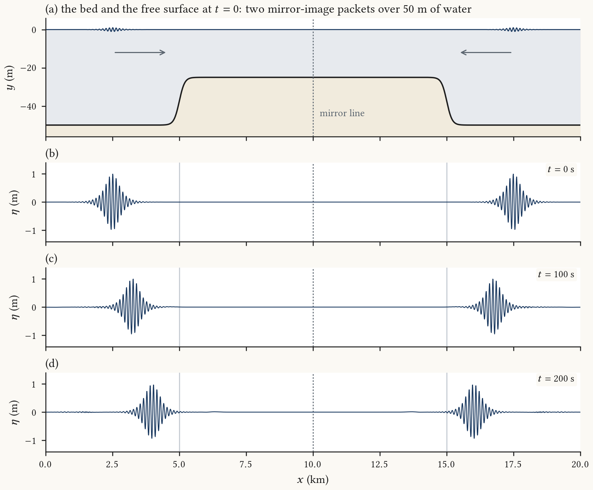
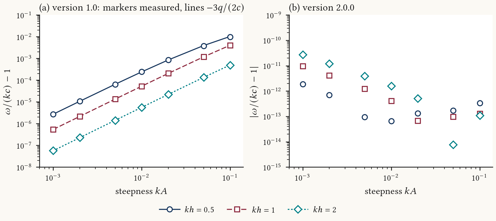
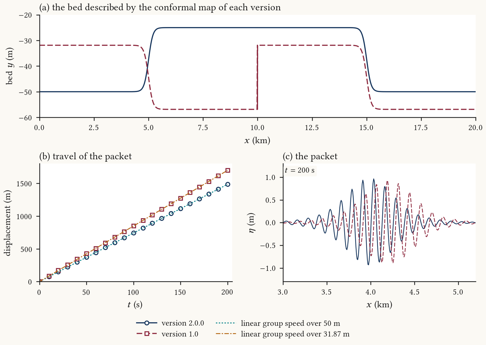

<!-- Author: Dr. Denys Dutykh (Mathematics Department, Khalifa University of Science and Technology, Abu Dhabi, UAE) -->

# Euler_bottom: water waves over a variable bed by conformal mapping



The figure shows the example of `runEuler.m` as version 2.0.0 computes it. Panel (a) shows the periodic domain of 20 km:
the bed lies
50 m deep, rises smoothly to 25 m at 5 km and falls back to 50 m at 15 km, its mirror image about the middle of the
domain (dotted line); at t = 0 the free surface carries two mirror-image wave packets of amplitude 1 m and wavelength
126 m, which travel towards the steps (arrows). Panels (b) to (d) show the elevation of the free surface at t = 0, 100
and 200 s: the packets move at 7.44 m/s, the linear group speed of such a packet over 50 m of water, and keep the mirror
symmetry; the grey lines mark the steps.

Euler_bottom is a MATLAB code that solves the full Euler equations of irrotational surface gravity waves (water waves)
over a bed of variable depth. The fluid layer is mapped conformally onto a strip of uniform width, the map is updated
at every time since it depends on the free surface, and the bed under the waves is found at every step by fixed-point
iterations; the evolution equations of the free surface in these conformal variables are discretised by a Fourier
pseudo-spectral method and integrated in time by an adaptive multistep solver. The method is described in the article
by C. Viotti, D. Dutykh and F. Dias in Procedia IUTAM (2014), cited below. Version 2.0.0 corrects several defects of
version 1.0, among them defects of the evolution equations shared with the published article: the section
"Corrections in version 2.0.0" states each correction, its effect on the results and the evidence, together with the
correct form of the published equations.

## The problem

The fluid is ideal and incompressible, of unit density, and the flow is irrotational. The domain is periodic in the
horizontal coordinate x, of period 2L; the bed is the curve y = −b(x), where the depth b(x) > 0 is given, and the free
surface y = η(x, t) is unknown. With subscripts denoting partial derivatives, the velocity potential Φ(x, y, t)
satisfies

```text
Φ_xx + Φ_yy = 0                          for −b(x) < y < η(x, t),
∂Φ/∂n = 0                                on the bed y = −b(x),
η_t + Φ_x η_x = Φ_y                      on the free surface y = η(x, t),
Φ_t + ½ (Φ_x² + Φ_y²) + g η = 0          on the free surface y = η(x, t).
```

The fluid layer is the image of the strip −d < Im w < 0 of the complex plane w = ξ + iσ under a conformal map
Z(w, t) = X + iY, with Z(w + 2L, t) = Z(w, t) + 2L, which sends the line σ = 0 onto the free surface and the line
σ = −d onto the bed. The labels ξ are the abscissas of the strip. The unknowns are, at each label, the elevation
γ(ξ, t) = Y(ξ, 0, t) of the surface point of label ξ and the velocity potential φ(ξ, t) there. Three operators act on
the Fourier modes exp(ikξ), k ≠ 0, as multiplications, and annihilate the mean:

```text
𝒞 : i coth(kd),        𝒮 : i csch(kd),        𝒢 : k tanh(kd).
```

The map is determined by the elevation γ and by the depth h(ξ, t) at the bed point of label ξ:

```text
x(ξ, t)   = x₀(t) + ξ − 𝒞γ − 𝒮h          abscissa of the surface point of label ξ,
x_b(ξ, t) = x₀(t) + ξ − 𝒮γ − 𝒞h          abscissa of the bed point of label ξ,
h(ξ, t)   = b(x_b(ξ, t)),                 d(t) = ⟨γ⟩ + ⟨h⟩,
```

where ⟨·⟩ is the mean over a period. The evolution equations solved by the code are

```text
x_ξ = 1 − ∂_ξ(𝒞γ + 𝒮h),        J = x_ξ² + γ_ξ²,
ψ_ξ = −𝒢φ,                     f = ψ_ξ / J,                 u = 𝒞f − q(t),
γ_t = u γ_ξ − x_ξ f,
φ_t = −g γ + (ψ_ξ² − φ_ξ²) / (2J) + u φ_ξ,
```

in which ψ is the stream function on the free surface, J the squared modulus of Z_w on the surface, and u the
tangential velocity with which the labels slide along it, common to the elevation and the potential. The constant q(t)
fixes the horizontal origin x₀ of the map. The code holds the bed point of the anchor label ξ* = −L + L/N, half-way
between the last and the first of the N labels, at x = −L, which requires q = (𝒮f)(ξ*). Each term of the two
evolution equations has the dimension of a velocity and of a velocity squared, respectively.

## The method

The interval −L < ξ ⩽ L is discretised by N equally spaced labels, and every operator is applied in Fourier space with
the fast Fourier transform. The derivatives, the operators of the evolution equations and the metric J are multiplied
by the smooth filter exp(−5 (|k| / (0.75 k_max))¹⁹), which removes aliasing. Since the depth h at the bed points
depends on the map, which depends on h, the bed under the current free surface is computed at every evaluation of the
right-hand side by the fixed-point iteration h ← b(x_b(γ, h)), started from h = b(ξ), until two iterates differ by less
than tol = 10⁻⁹ m. The values of γ and φ at the labels are then advanced in time by the MATLAB solver `ode113`, with
relative and absolute tolerances 10⁻¹⁰.

The function `b.m` returns the depth at the bed points of the first half of the labels and gives the second half their
mirror image, and the initial condition is mirrored in the same way. The computed motion is therefore symmetric about
the middle of the domain, x = 0, and also about its ends, which are images of each other by periodicity: the first half
of the domain is a basin of length L closed by two vertical walls.

## The example

The script `code/runEuler.m` computes a wave packet over a depth step. The gravity is g = 9.8 m/s², the domain has the
length 2L = 20 km and N = 4096 labels. Measured from the left end of the domain, the bed is 50 m deep up to 5 km, rises
there to 25 m over a smooth step (a hyperbolic tangent of length scale 200 m), and falls back to 50 m at 15 km, its
mirror image. The initial free surface is the packet

```text
η(x, 0) = a₀ cos(k₀ (x + L)) sech((x + L − p₀) / D₀),       a₀ = 1 m,  k₀ = 0.05 m⁻¹,  D₀ = 232 m,  p₀ = 2.5 km,
```

with the potential of the corresponding linear wave over 50 m of water, and its mirror image. The run lasts 200 s, with a
frame every 10 s.

In the corrected run the packet travels from 2500.0 m to 3988.6 m in 200 s, at 7.443 m/s between 30 and 180 s. Linear
theory gives the group speed 7.4215 m/s at the carrier wavenumber over 50 m of water, and 7.438 m/s when it is averaged
with the energy spectrum of the packet. Over the run the mass (the integral of η) is conserved to 4 × 10⁻⁸ m² and the
energy to 3 × 10⁻⁸ in relative terms, and the mirror symmetry is kept to 7 × 10⁻¹¹, the level of the rounding errors.
At t = 200 s the front of the packet reaches the foot of the step; a larger final time `Tf` in `runEuler.m` lets it cross.

## Quick start

In MATLAB, from the folder `code/`:

```matlab
runEuler
```

The window shows, every 10 s of simulated time from 0 to 200 s, the bed and the free surface over the first half of the
domain, the elevation and the potential at the free surface, and the Fourier spectrum of the elevation with the
de-aliasing filter. The run takes about 40 s on a desktop computer with one thread (MATLAB R2025b). The parameters of the
example are set at the top of `runEuler.m`, the bed in `code/problem/b.m` and the initial packet in
`code/problem/InitCond.m`.

The script needs MATLAB: GNU Octave has neither `ode113` nor the function `uistack` that the plots use, and refuses the
renderer that `runEuler.m` selects. The functions of the solver (`code/methods/` and `code/problem/`) run unchanged in
GNU Octave, which the tests and the scripts of the figures use with `ode45`.

## Tests

The folder `tests/` holds two tests against exact solutions. Each runs in a few seconds, in MATLAB or GNU Octave, from
the root of the repository:

```text
octave tests/test_conformal_map.m          in MATLAB:  run('tests/test_conformal_map.m')
octave tests/test_travelling_wave.m        in MATLAB:  run('tests/test_travelling_wave.m')
```

The first test takes the exact conformal map Z(w) = w + i m + Σ cₙ exp(inw) of a strip of width 0.8 onto a layer whose
depth varies between 0.55 and 0.87. Given the elevation of the free surface and the depth of the bed at each label,
`x.m` and `x_bot.m` must return the abscissas of the surface and bed points. It prints

```text
Exact map: |Z'-1| at most 0.12 on the surface and 0.39 on the bed
depth of the bed from 0.554 to 0.872, strip width 0.800
largest error of the surface abscissas (x.m):   1.8e-15
largest error of the bed abscissas (x_bot.m):   1.8e-15
test passed
```

The second test computes, with `tests/steady_wave.m`, an exact steady wave (Stokes wave) over a flat bed, in units where
g = 1 and the depth is 1: wavenumber 1, crest 0.1 above the mean level, phase speed c. It checks that `RHS.m` moves the
elevation and the potential along the labels with one common velocity, then integrates the wave over one period with
`ode45` and compares the free surface, mapped by `x.m`, with the initial wave translated by c t. In GNU Octave 11.1 it
prints

```text
Steady wave: kh = 1.0, crest elevation 0.10, phase speed c = 0.880692227526 (residual 1.7e-16)
(1) the right-hand side moves both fields with one velocity: residual 1.4e-15
(2) t = 1.7836 (0.25 period): largest deviation from the translated wave 5.3e-13
(2) t = 3.5672 (0.50 period): largest deviation from the translated wave 6.8e-13
(2) t = 5.3508 (0.75 period): largest deviation from the translated wave 8.0e-13
(2) t = 7.1344 (1.00 period): largest deviation from the translated wave 7.1e-13
test passed
```

MATLAB R2025b prints the same lines, with residuals and deviations of the same size. Version 1.0 fails both tests: its
map misses the exact one by 0.41 and 0.62, its right-hand side moves the two fields with velocities that differ by
3.3 × 10⁻⁴, and its free surface leaves the translated wave by 2 × 10⁻³ to 1.2 × 10⁻² within one period.

## Corrections in version 2.0.0

Version 1.0 (the code of February 2016, tag `v1.0`) implemented equations (22) and (23) of the published article,
with the value of the constant q prescribed there. Re-derived from the Euler equations and checked against exact
solutions in 2026, these equations and several parts of the code proved wrong, and version 2.0.0 corrects them all.
The corrections change the results: the example of version 1.0 described another bed than the one it was given, and its
packet travelled at the wrong speed. The effects quoted below are those on the example as version 1.0 computed it.

**One tangential velocity for the elevation and the potential** (`code/methods/RHS.m`). The labels slide along the free
surface with a tangential velocity that must transport the elevation and the potential alike. Version 1.0 moved the
elevation with 𝒞f + q and the potential with 𝒞f, two velocities that no choice of labels can produce, so that its
equations were not those of water waves as soon as q ≠ 0, in particular for every travelling wave. Version 2.0.0
transports both with u = 𝒞f − q. Exact steady waves now travel at their phase speed: their frequency is exact to
3 × 10⁻¹¹ for every depth and steepness tried, whereas version 1.0 makes them oscillate too fast by −3q/(2c), which for
small waves is (3/4)(kA)² csch²(kh), with A the crest elevation: 4.0 × 10⁻³ at kh = 1 and kA = 0.1 (figure below).
The momentum of version 1.0 was not conserved either. The example has no current and is nevertheless affected, since q
does not vanish for travelling waves.

**The sign of the bed in the map** (`code/methods/x.m`, `x_bot.m`, `RHS.m`). The formulas of the map were written, as in
the article, for the elevation of the bed, which is negative, but `b.m` returns the depth. The map of version 1.0 was
therefore the exact map of another bed, the depth profile reflected about twice its mean: in the example the waves ran
over 31.87 m of water deepening to 56.87 m, instead of 50 m shoaling to 25 m, and the packet travelled at 8.482 m/s, the
group speed over 31.87 m (8.488 m/s), instead of 7.443 m/s. The bed now enters with the sign of its elevation, and the
map reproduces an exact conformal map with a non-flat bed to 1.8 × 10⁻¹⁵ (`tests/test_conformal_map.m`).

**The constant of the tangential velocity** (`code/methods/RHS.m`, `anchor.m`). The constant q(t) fixes the horizontal
origin of the map. Version 1.0 took the value that the article prescribes, which has the wrong sign: with it the mean
origin drifts at the speed 2q instead of staying still. Moreover the code does not keep the mean origin still but a bed
point, from which `b.m` builds the bed. Version 2.0.0 takes the value that holds that bed point still, q = (𝒮f)(ξ*), so
that the motion of the labels and the reconstruction of the bed use the same origin. For the mirror-symmetric motions of
the example this value vanishes, and the anchored bed point stays still by symmetry.

**One origin for the surface and the bed** (`code/methods/x.m`). The function `x.m` placed the surface point of the
first label at x = −L, while `x_bot.m` placed the bed point of that label there, and the two points are not above one
another. In the example of version 1.0 the surface was placed 23.5 m to the left of the bed it moves over: the packet,
meant to start at 2500 m, started at 2475.8 m. Version 2.0.0 gives the surface the origin of the bed, and the packet
starts at 2500.0 m.

**The plot** (`code/methods/Plot.m`). The plot mapped the free surface with the depth taken at the labels rather than at
the bed points, and drew the formula of `b.m` instead of the bed of the solver. In version 1.0 the packet was drawn at
2140 m while the solver held it at 2499 m, parts of the surface up to 530 m away from their computed place, and the
picture showed the intended bed whatever bed the map described, which hid the error of sign. The plot now runs the bed
iteration of `RHS.m` and draws the converged bed y = −h at the bed abscissas, with the free surface over it.

**The time of the frames** (`code/runEuler.m`). Every frame after the first was labelled 10 s early, and the run ended
at 210 s although its final time is `Tf = 200`. The frames now carry their true times and the run ends at `Tf`.

**The initial free surface** (`code/problem/InitCond.m`). The initial packet was mapped with a bed obtained by a single
evaluation of `x_bot.m` instead of the converged bed, and in version 1.0 its elevation missed the formula of the packet
by up to 3.8 × 10⁻² m at the computed abscissas. It is now mapped with the bed iteration of `RHS.m`, and the initial
elevation equals the formula to 5 × 10⁻¹⁰ m.

**A dead path** (`code/runEuler.m`). The line `addpath export_fig/` named a folder that the repository does not hold and
that no function uses; it is removed.

**The mirror image** (`code/problem/b.m`, `InitCond.m`, and the anchor in `code/methods/`). The functions `b.m` and
`InitCond.m` completed the second half of the labels with `fliplr`, which leaves a column vector unchanged. The domain
therefore held two identical copies of the configuration, and the depth jumped by 25 m between two neighbouring labels at
each junction of the copies (panel (a) of the second figure below). They now use `flipud`: the second half is the mirror
image of the first, the bed goes smoothly from 50 m to 25 m and back to 50 m (the largest change of depth between
neighbouring labels is 0.35 m, within the steps), and the mirrored packet travels the other way. The mirror points of the
grid lie half-way between labels, so the map is anchored at the label ξ* = −L + L/N, one of them (`anchor.m`). The
right-hand side of a mirror-symmetric state is then symmetric to 2 × 10⁻¹⁵, and over the 200 s of the example the
motion departs from the symmetry by at most 7 × 10⁻¹¹, the accumulated rounding errors; anchored at the first label, as
before, it departed by 2 × 10⁻⁶ within 20 s.



Frequency of exact steady waves over a flat bed, in units where g = 1 and the depth h is 1, for three relative depths kh
and seven steepnesses kA (A the crest elevation), measured over four periods at a fixed label and compared with the
exact frequency kc. Panel (a): version 1.0 (markers) oscillates too fast by −3q/(2c) (lines), the error of its transport
term, which grows like the square of the steepness. Panel (b): version 2.0.0 is exact to the tolerance of the integrator,
within 3 × 10⁻¹¹, at every steepness.



The example of `runEuler.m` computed by both versions. Panel (a): the bed described by the conformal map of each
version; version 1.0 computed the waves over the reflected bed, 31.87 m deepening to 56.87 m, with a jump of 25 m at
the junction of its two copies. Panel (b): the displacement of the packet of the first half of the domain, each version
following the linear group speed of the depth it really computed. Panel (c): the two packets at t = 200 s, that of
version 1.0 about 200 m ahead.

**The published equations.** The transport of version 1.0 was that of the published equations, whose defects are
corrected as follows; the article carries two further defects, in its bed iteration and on page 114, which the code did
not share. In the notation of the article, 𝒯_x is its conjugation operator (the operator 𝒞 above, with the short-hand
𝒯_x[a] = 𝒯_x[a, 0]), m(·) the mean over a period, y and h the elevations of the free surface and of the bed in the
conformal variables, ϕ the potential, φ = ϕ − 𝒰ξ its periodic part and 𝒰 the mean current; its q(t) is the negative of
the q of the code. Equations (21) and (22) hold for any q(t), but
the value prescribed after them, on page 114, has the wrong sign: with it the mean of x_t equals
2 m(x_ξ 𝒯_x[ψ_ξ / J] + y_ξ ψ_ξ / J) instead of zero, and the origin x₀ drifts. The value that keeps x₀ constant, as the
article intends, is

```text
q(t) = − m( x_ξ 𝒯_x[ψ_ξ / J] + y_ξ ψ_ξ / J ).
```

Equation (23) lacks the term q ϕ_ξ that its own equation (20) carries, and equation (24) the term q (φ_ξ + 𝒰). They read

```text
ϕ_t = −(1/J) [ ½ ϕ_ξ² − ½ ψ_ξ² − J ϕ_ξ (𝒯_x[ψ_ξ / J] + q) ] − g y + C(t),                           (23)
φ_t = −(1/J) [ ½ (φ_ξ + 𝒰)² − ½ ψ_ξ² − J (φ_ξ + 𝒰)(𝒯_x[ψ_ξ / J] + q) ] − g y + C(t).                (24)
```

With a mean current 𝒰 = ±0.25 added to the right-hand side as in (24), in units where g = 1 and the depth is 1, the
corrected equations give the exact frequency k(c + 𝒰) of steady waves to 3 × 10⁻¹¹, which the published ones miss by
5 × 10⁻⁸ to 10⁻². Equation (25), the fixed-point iteration for the bed, computes with the operator of the free surface,
that of (18), the abscissa of the surface point instead of that of the bed point (the code used the right operator);
the bed abscissa is the integral of the article's equation (16):

```text
χ⁽ⁿ⁾ = ξ + 𝒯_x[h⁽ⁿ⁾, y].                                                                              (25)
```

On page 114 the substitution that leads to (24) is written ϕ = φ − 𝒰ξ; since φ = ϕ − 𝒰ξ, it is ϕ = φ + 𝒰ξ, which is the
one that (24) uses. Equation (4) also carries a misprint of sign: its last sum must be subtracted for Y(ξ, −h̄) to equal
h, and equations (5) and (6), which follow from it, are correct.

## Contents

| Path | Content |
|---|---|
| `code/runEuler.m` | the example: parameters, initial condition, time loop and plots |
| `code/methods/RHS.m` | the right-hand side of the evolution equations, with the bed iteration |
| `code/methods/x.m`, `x_bot.m` | the abscissas of the surface and bed points of the labels |
| `code/methods/anchor.m` | the anchor label of the map and the weights that evaluate a function there |
| `code/methods/Plot.m`, `fill_between.m` | the plots of `runEuler.m` |
| `code/problem/b.m` | the depth of the bed and its mirror image |
| `code/problem/InitCond.m` | the initial wave packet and its mirror image |
| `code/odebar/` | the progress bar of the time integration |
| `tests/` | the two tests and the solver of steady waves they use |
| `docs/figures/` | the figures of this page and the scripts that make them |

The figures are made in two stages, from the folder `docs/figures/`: `example_data.m` and `frequency_data.m` (MATLAB or
GNU Octave) compute and write the data, and `plot_figures.py` (Python 3 with NumPy and Matplotlib, with the style file
beside it) draws them. The comparisons with version 1.0 need a copy of it beside this one, made by
`git worktree add ../Euler_bottom-v1.0 v1.0`; the header of `plot_figures.py` gives the commands.

The function `fill_between.m` (written by Ben Vincent, 2014) and the progress bar of `code/odebar/` (`textprogressbar.m`
by Paul Proteus, 2010, with `odetpbar.m`, which calls it from the integrator) are third-party functions bundled for
convenience; they keep the terms of their authors.

## Requirements

MATLAB for `runEuler.m` (tested with R2025b), without toolbox. The functions of the solver, the tests and the scripts of
the figures also run in GNU Octave (tested with 11.1). The figures are drawn with Python 3, NumPy and Matplotlib.

## How to cite

If you use this code, please cite the article:

C. Viotti, D. Dutykh and F. Dias, The Conformal-Mapping Method for Surface Gravity Waves in the Presence of Variable
Bathymetry and Mean Current, Procedia IUTAM 11, 110–118 (2014).

https://doi.org/10.1016/j.piutam.2014.01.053

```bibtex
@article{Viotti2014,
  author = {Viotti, C. and Dutykh, D. and Dias, F.},
  title = {The {{Conformal}}-Mapping {{Method}} for {{Surface Gravity Waves}} in the {{Presence}} of {{Variable Bathymetry}} and {{Mean Current}}},
  journal = {Procedia IUTAM},
  year = 2014,
  volume = {11},
  pages = {110--118},
  doi = {10.1016/j.piutam.2014.01.053}
}
```

The button "Cite this repository" in the right-hand column of this page gives the same reference, read from
`CITATION.cff`. Equations (21) to (25) of the article are superseded by the corrected equations of version 2.0.0, given
above, which are the ones this code solves.

## Licence

GNU General Public License, version 3 (see `LICENSE`).

## Authors

The code is written by Denys Dutykh (Mathematics Department, Khalifa University of Science and Technology, Abu Dhabi);
the method is that of the article by C. Viotti, D. Dutykh and F. Dias. The author thanks Professor
[Yury Stepanyants](https://staffprofile.unisq.edu.au/profile/yury-stepanyants) (University of Southern Queensland,
Australia) for bringing this problem to his attention.

https://www.denys-dutykh.com/
